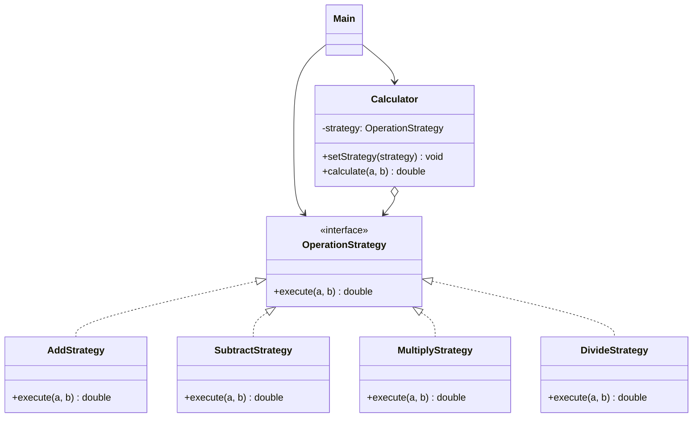

# Assignment 5 | Strategy

- **Name:** Alikhan Smagul
- **Group:** SE-2529
- **Repository:** https://github.com/alihzzz/SDP_Assignment5.git


## Idea
A calculator can perform different operations: add, subtract, multiply, divide.
Putting all of them into one method with `if/else` makes the code hard to extend.
Each operation is moved into its own strategy, and `Calculator` just uses the
strategy it was given. The strategy can be changed at runtime:

```java
calculator.setStrategy(new SubtractStrategy());
calculator.calculate(10, 5);
```

## Structure
```
src/
  strategy/   OperationStrategy, AddStrategy, SubtractStrategy, MultiplyStrategy, DivideStrategy
  context/    Calculator
  Main.java
```

## UML class diagram


## How to add a new strategy
1. Create a class in `src/strategy/` that implements `OperationStrategy`.
2. Implement `execute(double a, double b)`.
3. In `Main`, call `calculator.setStrategy(new YourStrategy());`

No existing class needs to be changed.

## How to run
```
javac -d out $(find src -name "*.java")
java -cp out Main
```
Or open the folder in IntelliJ IDEA and run `Main`.
