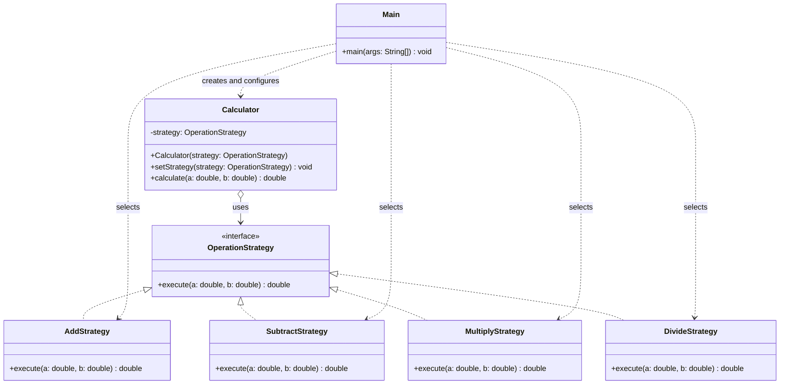

# Assignment #5 - Strategy Pattern

## 1. Introduction

I chose **Option B - Calculator**. The family of algorithms is the arithmetic
operations: addition, subtraction and multiplication. Each operation takes two
numbers and returns a result, but the way the result is calculated is different.
The Strategy pattern lets the `Calculator` use any of these operations without
knowing how they work, and the operation can be changed at runtime.

## 2. UML class diagram



Roles:
- **Strategy interface:** `OperationStrategy`
- **Concrete strategies:** `AddStrategy`, `SubtractStrategy`, `MultiplyStrategy`, `DivideStrategy`
- **Context:** `Calculator`
- **Client:** `Main`

## 3. Clean Code

### 3.1 Elimination of conditional logic in favor of polymorphism

Before (conditional chain):
```java
public double calculate(String operation, double a, double b) {
    if (operation.equals("add")) {
        return a + b;
    } else if (operation.equals("subtract")) {
        return a - b;
    } else if (operation.equals("multiply")) {
        return a * b;
    } else if (operation.equals("divide")) {
        return a / b;
    }
    return 0;
}
```

After (polymorphism):
```java
public double calculate(double a, double b) {
    return strategy.execute(a, b);
}
```

Why: there is no `if`/`switch` on the operation type. The correct code is chosen
by the object that is stored in the `strategy` field.

### 3.2 Meaningful, intention-revealing names

```java
public class AddStrategy implements OperationStrategy { ... }
public class SubtractStrategy implements OperationStrategy { ... }
public class MultiplyStrategy implements OperationStrategy { ... }
public class DivideStrategy implements OperationStrategy { ... }
```

Why: the class name says what the strategy does, so no comments are needed.
Names like `Strategy1` or `OpA` would force the reader to open the class.

### 3.3 Single Responsibility Principle

```java
public class MultiplyStrategy implements OperationStrategy {
    @Override
    public double execute(double a, double b) {
        return a * b;
    }
}
```

Why: each strategy has exactly one reason to change. `MultiplyStrategy` does not
print, does not read input and does not know about other operations.

### 3.4 Context is algorithm-agnostic

```java
public class Calculator {
    private OperationStrategy strategy;
    ...
}
```

Why: `Calculator` imports only `OperationStrategy`. It does not know about
`AddStrategy`, `SubtractStrategy`, `MultiplyStrategy` or `DivideStrategy`, so it never needs to change
when the algorithms change.

### 3.5 Easy extensibility (Open/Closed)

To add division, only a new class is written:
```java
public class DivideStrategy implements OperationStrategy {
    @Override
    public double execute(double a, double b) {
        return a / b;
    }
}
```
and the client uses it:
```java
calculator.setStrategy(new DivideStrategy());
```

Why: no existing class is modified. In the old `if/else` version, every new
operation required editing the `calculate` method.

## 4. Strategy vs. State

My problem needs **Strategy**, not State. In the calculator, the operation is
chosen from outside by the client (`Main`), and the strategies are independent:
`AddStrategy` knows nothing about `SubtractStrategy` and never switches to it.
The strategies are different ways to do the same job, and they do not depend on
the history of the object.

In **State**, the object changes its behavior because its own internal state
changes, and the state objects usually know about each other and make the
transitions themselves (for example, a document going from Draft to Moderation
to Published). Here nothing like that happens: the calculator has no lifecycle
and no transitions, so State is not suitable.

## 5. Conclusion

The pattern gave flexibility: a new operation can be added by writing one new class
without changing `Calculator` or the existing strategies, and the operation can be
changed at runtime. The price is more classes: one interface and three strategies
instead of one method with `if/else`. For three simple operations this is more code
than needed, but when the number of algorithms grows or they become more complex,
the structure stays clean and easy to extend.

## 6. GitHub repository
https://github.com/alihzzz/SDP_Assignment5.git

